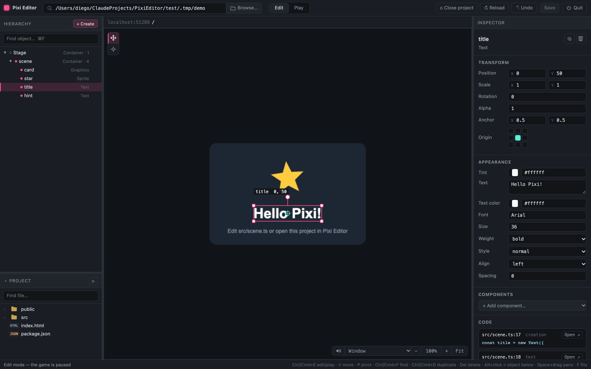
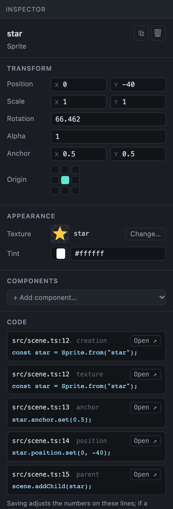
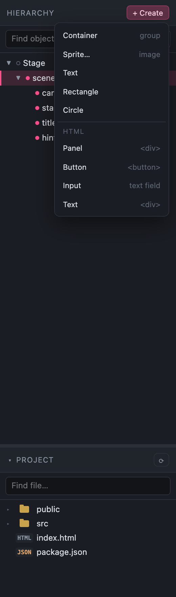
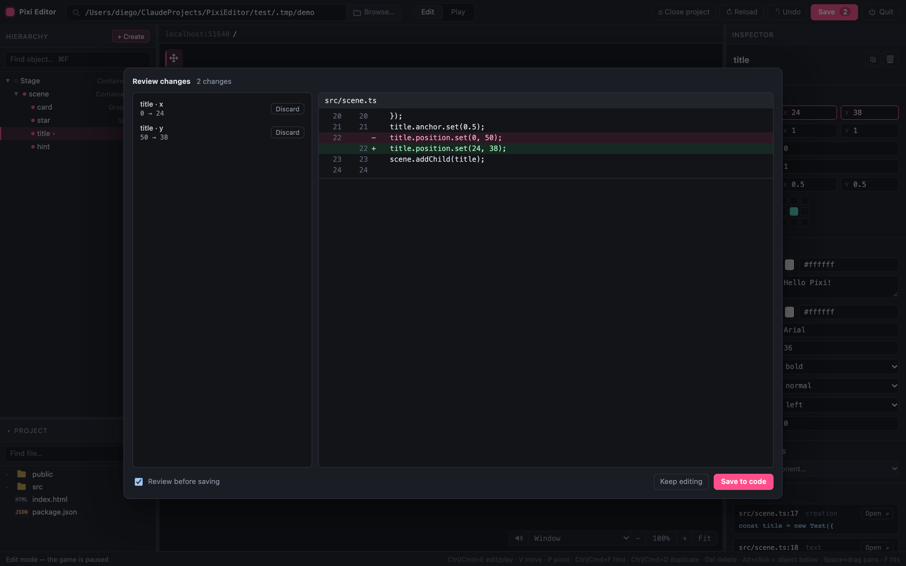

# Pixi Editor

A visual scene editor for **PixiJS v8 projects that live entirely in code**.

Open a project your team wrote by hand, arrange the scene the way you would in Unity or
Cocos, and when you save, the editor writes the change back into the source. Nobody has to
leave their code: the edits land as an ordinary git diff.



Drag an object two pixels to the right and the editor doesn't dump a new scene file on you.
It edits the one line that set the position, and leaves the rest of the expression alone:

```ts
// Before
scoreText.position.set(22, 18);
netText.position.set(app.renderer.width - 10, 10);

// After nudging both in the editor and saving
scoreText.position.set(40, 26);
netText.position.set(app.renderer.width - 24, 10);   // still anchored to the right edge
```

## Why it exists

Most scene editors want to own your project. They add a runtime, a scene format, a build
step, and from then on the layout lives in their files instead of your code. That trade is
fine until you have a team that would rather keep everything in TypeScript and review it on
GitHub.

Pixi Editor takes the opposite approach. It reads your existing code, shows you the scene it
produces, and when you move something it changes the number that was already there. There is
no scene file, no lock-in, and no "export" step. Close the editor and the project is exactly
what it was, plus the lines you changed.

## Highlights

- **It edits your real source.** Moving, scaling, recoloring or renaming an object rewrites
  the exact line that set that value, keeping expressions like `app.renderer.width - 24` or
  `44 + i * 22` intact. When a value has no line yet, one is inserted right after the object
  is created.
- **No changes to your project.** The editor runs *your* Vite with one plugin added. Your
  config, your dependencies and your code are left as they are.
- **A real inspector.** Position, scale, rotation, alpha, pivot and anchor, plus textures,
  tint, spine animations, and full text styling. Every field lists the lines of code behind
  it, one click from your editor.
- **It reads code the way people actually write it.** Plain `new Sprite()`, TypeScript casts
  (`new Application() as GameApp`), and factory helpers (`createSprite({ position: [x, y] })`).
- **HTML and CSS, not just the canvas.** Menus and forms built with the DOM are selectable
  and draggable; the editor writes back their inline styles, attributes, text and even the
  CSS rules that position them.
- **Structural edits stay honest.** Create, duplicate, delete, reparent and reorder objects
  as plain code. When other code depends on an object, the editor refuses and tells you why
  instead of guessing.
- **Nothing is saved behind your back.** Every change goes through a review dialog that shows
  the diff per file, with a Discard button next to each one.

## Getting started

```bash
cd PixiEditor
npm install                 # first run only
node bin/pixi-editor.js     # opens http://localhost:5180/__pixi-editor/
```

Options: `--port 5200`, `--no-open`, or a project path to open straight away
(`node bin/pixi-editor.js ~/games/firstProject`).

**On macOS without a terminal**, double-click **`PixiEditor.app`** in this folder (drag it to
the Dock to keep it around). It locates Node.js on its own, runs `npm install` the first time,
starts the editor in the background and opens the browser. **Quit** in the top bar stops it,
and the log lives in `~/.pixi-editor/editor.log`. `pixi-editor.command` does the same in a
visible Terminal window.

## Opening a project

You pick the project from inside the app, so there is no config file to point anywhere:

- **Search bar** (`Cmd/Ctrl+P`) filters your recent projects as you type, or takes a pasted
  folder path.
- **Browse…** (`Cmd/Ctrl+O`) opens the system folder picker.
- **＋ New project…** scaffolds a fresh Vite + PixiJS v8 + TypeScript game (optionally with
  ESLint and Prettier), installs it and opens it.

The only requirements are that the project uses Vite and creates its app with
`new Application()` somewhere. If the game talks to a backend, start that the way you normally
would; the editor only runs the front end.

## Inside the editor

The game boots in **Play** so loading screens, tweens and intros run normally. When you reach
the screen you want to work on, switch to **Edit** (`Cmd/Ctrl+E`): the game pauses and objects
become selectable.

| | |
|---|---|
| **Select** | Click the top-most object. `Alt`+click cycles through whatever is stacked under the pointer. |
| **Move (V)** | Drag to move (`Shift` locks an axis), corner handles scale, the handle above rotates. Arrow keys nudge by 1 px, `Shift` by 10. |
| **Pivot (P)** | Drag to place the object's origin (`anchor` for sprites and text, `pivot` for the rest). The object stays put while its origin moves. |
| **Zoom / pan** | Wheel or pinch to zoom around the pointer, `Space`+drag to pan, `F` to fit, `0` to reset. |

### The inspector

Select an object and the inspector fills in: its transform, its appearance, the components
on it, and **every line of code that controls it**, each with the file, the line number and an
*Open* button that jumps there in VS Code (or `PIXI_EDITOR_IDE=cursor`, etc.).



Drag a field's label to scrub the value, the way you would in Unity. Text objects expose font,
size, weight, style, alignment and spacing; sprites expose their texture (with a picker of
everything the game has loaded) and tint; spines expose their skeleton and a live animation
preview.

### Scene tree and project files

The hierarchy mirrors the live scene. A pink dot means the object is linked to a line of code.
**+ Create** adds a Container, Sprite, Text, Rectangle, Circle, or an HTML Panel / Button /
Input / Text, and writes the code for it right away.



Below the tree, the **Project** panel browses the repo (minus `node_modules` and friends).
Click a file to preview it in the inspector: source with syntax highlighting, images on a
checker background, sounds with a scrubbable waveform, and spine skeletons playing their
animations. Double-click to open it in your editor.

## Saving rewrites your source

Press `Cmd/Ctrl+S` and the **Review changes** dialog shows exactly what will change, grouped
by file, with the before/after lines side by side. Accept it and only those lines move.



Here is what happens under the hood. While the game runs inside the editor, its code is
instrumented *in memory* (never on disk) to record which line set each property of each
object. On save, the editor adjusts the number on that line and keeps the expression around
it: `22` becomes `40`, `app.renderer.width - 10` becomes `app.renderer.width - 24`,
`someVar` becomes `someVar + 5`. Text, names and colors replace the literal in place. If a
value is computed by code (`i18n.t(...)`, a template string), the editor won't overwrite it;
it says so and reverts the preview instead of guessing.

Files that were already Prettier-clean are reformatted after the save, so your lint stays
green. Files your team never formatted are left untouched.

A few things it deliberately won't do:

- A line inside a loop or a shared helper affects **every** object it builds, so the inspector
  warns when a change touches more than one object.
- Objects with no variable of their own (`world.addChild(new Sprite())`) can be moved to try
  things out, but there is no line to save them to.
- Code that sets a position every frame will snap the object back while you edit. Your saved
  change still applies.

## It fits how your team writes code

Not every project calls `new Sprite()`. Many build objects through helpers, and the editor
treats those as the object's creation point:

```ts
createSprite({ texture: TEX.BACKGROUND, parent: balanceGroup, anchor: 0.5, position: [178, -25] });
```

It names the object after its label, text or texture, edits the values inside the options
object (`position: [178 + 20, -25]`), and adds a property to the call when the project already
uses that helper with that key elsewhere. Function names matching `create…`, `make…` or
`build…` are recognized out of the box. Constants are followed too, so changing a sprite's
texture rewrites `TEX.HUD.COIN` to `TEX.HUD.GEM` rather than inlining a string.

Structural edits work the same way. **Duplicate** copies the object's setup lines with a fresh
variable name; **Delete** removes the declaration and every line that used it, including its
entry in `children: [...]` arrays and any import that goes unused. Reparenting and reordering
rewrite the `addChild` call or the `children` list and adjust the position so the object stays
where it was on screen. If something else in the code still needs the object, the edit is
refused and the offending lines are shown.

## HTML and CSS over the canvas

Plenty of games draw their menus, name screens and login forms with the DOM on top of the
canvas. Those elements show up under **Page (HTML)** in the hierarchy and select like any other
object. Drag one to move it and the editor edits its CSS: `left`/`top`, or `right`/`bottom`
when that is the edge holding it, so a menu pinned to `right: 16px` stays pinned. Units are
preserved (`%`, `vw`, `em`), and the inspector lists both the element's inline style and the
CSS rules that apply to it, each with its file and line.

HTML written as a string (`mount.innerHTML = \`<section class="panel">…\``) is linked too: the
fixed parts of each tag are saved back into the template, while anything built from `${…}` is
shown but never overwritten.

For Pixi-native HTML, **Create → HTML** writes real elements wrapped in Pixi's `DOMContainer`,
so they move, scale and fade with their container like any display object.

## Components and behaviors

The inspector's **Add component…** menu attaches small, reusable pieces of behavior, written
into the project as plain code:

| Component | What it does |
|---|---|
| **Anchor** (layout) | Keeps the object a fixed offset from a screen edge or corner, and follows resizes. |
| **Button** (ui) | Pointer cursor plus hover/press scale feedback; you handle the click in code. |
| **Tween** (animation) | A looping idle animation (pulse, float, spin, fade) on top of the object's values. |

Components live in `src/pixi-components/`, one file per component, grouped by category. Only
the categories a project actually uses are copied in, and each category's `index.ts` only
re-exports, so unused components stay out of the build. The files are strict TypeScript,
formatted with your Prettier, and safe to edit and commit; the editor never overwrites them.

Need something custom? **New behavior…** creates a class for the selected object and opens it
in your editor. It is attached in the code immediately, so it keeps working after a reload:

```ts
export class CoinSpinner extends Component {
  static readonly componentName = "CoinSpinner";

  attach(): void {
    this.target.eventMode = "static";
    this.target.on("pointertap", () => this.target.scale.set(1.2));
  }

  update(): void {
    if (isEditorPaused()) return; // hold still while the editor is paused
    this.target.rotation += 0.02;
  }
}
```

## Development

```bash
npm install                      # also pulls vite, pixi.js, prettier and playwright
npx playwright install chromium  # once per machine, for the browser tests
npm test                         # unit tests: instrumenting and rewriting code (~1s)
npm run e2e                      # browser tests against the fixtures in test/fixtures (~30s)
```

The end-to-end suite copies three fixture projects into `test/.tmp`, starts the editor on each
one, drives it in Chromium and checks the exact code it writes. The fixtures cover the three
styles the editor has to handle: `basic` (plain `new X()`), `factory` (`createSprite({...})`
helpers and `TEX` constants) and `templates` (UI built from an `innerHTML` template and styled
by a CSS file). Run a subset with `npm run e2e -- factory`, or watch it with `HEADED=1`.

## Project layout

```
bin/pixi-editor.js   CLI entry point
PixiEditor.app       macOS launcher (also pixi-editor.command)
src/server.js        Editor server: UI, project picker, hosts the project's Vite
src/plugin.js        Vite plugin: instruments code, injects the runtime, saves changes
src/instrument.js    Parses code (Babel) and marks the code site of each property
src/writeback.js     Computes the text edits ("adjust only the number")
src/runtime.js       Injected into the game to link objects to lines of code
src/refactor.js      Delete, duplicate and reorder an object's code
src/html.js          index.html elements and innerHTML templates: read and write back
src/css.js           Project CSS files: rules and declarations
templates/           New-project scaffold and the component library
editor/              The UI (dependency-free HTML/CSS/JS)
test/                Unit tests (run.js) and browser tests (e2e/run.js)
```

## Roadmap

- Multi-selection with alignment and distribution tools.
- More components: `@pixi/layout`, sprite-sheet animation, sound on click.
- Stroke and drop shadow for text.

## License

MIT
